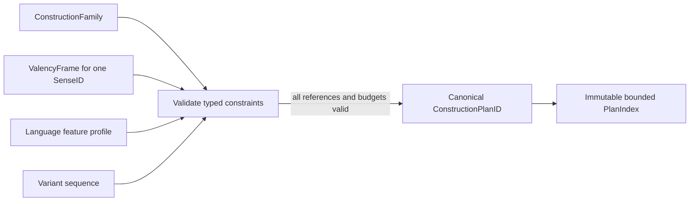

# Construction constraint compiler

`CompileConstruction` validates one manually authored language profile,
construction family, sense-specific valency frame, and variant at data load or
build time. A request can then use the immutable `CompiledConstructionPlan`
without walking or interpreting grammar JSON in its hot path.

Constraint kinds are closed: `agree` links explicit controller and target
feature paths; `govern` records an explicit case policy for one slot;
`require` accepts a bounded typed predicate; `precede` adds an ordered slot
edge; and `optional` confirms that a slot was already declared optional.
Predicates contain no executable expression. Agreement dimensions must exist
in the selected language profile. Case labels and adpositions remain
language-specific policy; semantic roles do not imply grammatical functions.

Compilation rejects unknown slots, arguments, profile features and variants;
contradictory case/adposition policy; an unbound required frame role; a
required slot omitted by a variant; and precedence cycles. Soft agreement is
retained as a preference for later evaluation; hard agreement remains a
mandatory constraint. No condition or role is silently discarded.

The compiler preserves the exact variant linearization order. Constraint
records, argument bindings and procedure references are canonicalized for the
plan digest; linearization is not reordered. Structural plans are indexed by
`ConstructionPlanID` and duplicate IDs are stored once. A shared record keeps
an explicit list of the `SenseID`/`FrameID` permissions that compiled to it;
the plan identity does not grant permissions to any sense absent from that
list.

The work is bounded by `MaxCompiledPlans`, `MaxCompileItems`, family/frame
limits, `MaxPlanConstraints`, and predicate depth/node budgets. Compilation
processes only supplied records; it does not combine families, variants and
lexemes into a cartesian product. Exhausted budgets return
`resource_limit`; malformed input, missing references and unsupported policy
remain distinct outcomes.

This compiler checks structural and feature-policy consistency. It does not
claim that a Polish or English sentence has been realized correctly; that
requires an explicit sentence, lexical data, and a realization stage.
