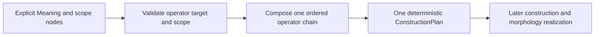

# Construction operators and semantic scope

Operator composition takes place after an explicit Meaning and before
surface-form selection. An operator is a bounded record with a closed kind,
explicit value and semantic target, input/output family IDs, dependencies,
required capabilities, and provenance. JSON stores no script and the runtime
does not evaluate arbitrary code.

`Compose` preserves the exact caller-supplied order. Each operation must be
licensed by the current family and selected `ValencyFrame`, match that family's
declared capabilities, and point to a registered output family in the same
language that the frame also licenses. Every required frame role must be bound
by the participating family. The next operator's input family must match the
previous output family. Declared dependencies must occur earlier in the chain.
The returned plan records `SenseID` and `ValencyFrameID`; its identity hashes
the ordered steps, scope node IDs, values, family transitions, dependencies and
capabilities. Changing operator order produces a different identity. No
combinations are sorted, assumed commutative, or materialized as a cartesian
product.

| Kind | Explicit value | Meaning scope required |
| --- | --- | --- |
| tense | past, present, future | event node |
| negation | negated | `Scope` node marked negation and targeting the event/state |
| question | yes/no or WH | `Question` node or question `Scope` targeting the event/state |
| voice | active or passive | event node |
| modality | possible, necessary, likely | `Modality` node with the same value and target |

Tense and voice values are explicit because the current Meaning IR does not
store those dimensions. Negation, question, and modality must agree with their
explicit Meaning scope nodes. The API never supplies a missing value or moves an
operator to a nearby node. A future planner can expand this closed vocabulary
only with a reviewed change.

## Scope, order, and failure behavior

For example, if a plan applies tense, then negation, then question, the plan
stores those three steps in that order. A request that lists question before
tense is a separate plan and receives a different `ConstructionPlanID`; this
does not claim the two orders are valid or equivalent in any language. An
operator chain is accepted only if every transition and dependency is licensed.

- A passive operator without `voice-passive` on the required families returns
  `unsupported`; it does not select active voice by default.
- Missing operator target/scope returns `incomplete`; a dangling target returns
  `unknown`.
- A dependency omitted from the request returns `incomplete`; a dependency
  placed after its dependent operator returns `unsupported`.
- Input/output family mismatch or conflicting values for the same operator
  kind and semantic target is refused before a plan is returned.
- Asking for a family in another language is `unsupported`. A missing family is
  `unknown`.

The plan contains one selected path only. Even if a language has many operators
and families, composition work is bounded by the supplied chain length; it does
not enumerate every combination for every lexeme. This step validates and
orders plans; it does not claim sentence-level realization or translation.
