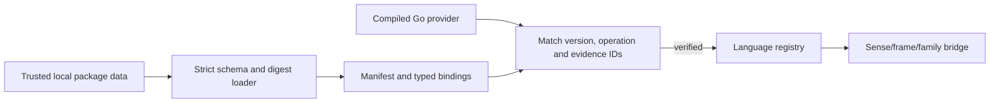

# Language data packages and Go providers

Language packs are local data. A package contains a strict `package.json` with
a schema version, canonical language/version, declared capabilities, optional
module filenames and their SHA-256 digests, and typed sense/frame/family
bindings. The loader reads only the selected local directory; it does not
fetch remote content, follow module path components, or accept symlink files.
Every JSON object rejects unknown fields, and package/module bytes are bounded.

JSON never contains code. The only executable implementation is a compiled Go
`LanguageProvider`. An `implemented` manifest declaration is accepted only
when a provider for the same language and version supplies the same capability,
direction flags, and evidence case IDs. A data-only declaration cannot make a
capability available. Unimplemented declarations do not appear in the
registry's verified capability list.

Bindings keep `SenseID`, valency frame, construction family, variant IDs,
`CoreRef`, an `equivalent` mapping, explicit approval and valid provenance,
and analyze/realize permission explicit. The bridge checks provider
analysis candidates against that exact binding. Realization requires a
compiled plan whose family, variant, language, and sense/frame permission all
match. No global subject/agent mapping is inferred.

PL and EN packages are not bundled by this change. The bootstrap CLI continues
to report no languages and no translation support until an actual local pack
and matching compiled provider are installed and wired. This contract does
not claim sentence-level quality; provider evidence must identify reviewed
case IDs, while actual sentence review remains a separate manual step.

Native shared-object plugins, `eval`, arbitrary JSON procedures, automatic
network access, and mutable global registries are outside the contract.
