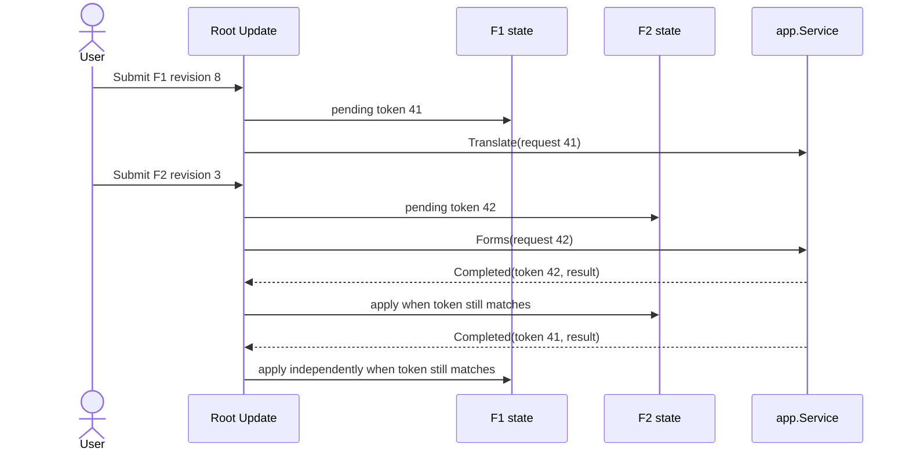

# Model stanu, zdarzeń i fokusu TUI

Ten dokument opisuje kontrakt MVU dla przyszłego TUI GoLingua. Nie dodaje
implementacji ani nie zmienia zachowania CLI. Nazwy pól i zdarzeń poniżej są
stabilnym słownikiem projektu; implementacja może dobrać idiomatyczne typy Go,
zachowując opisane własności.

## Własność stanu

Model główny posiada stan powłoki, wybór ekranu, rozmiar terminala i cykl życia
aplikacji. Każdy ekran posiada własny szkic wejściowy, wynik, selekcję i
identyfikatory oczekujących operacji. Przełączenie ekranu nie kasuje roboczego
stanu pozostałych ekranów.

| Właściciel | Stan |
| --- | --- |
| Powłoka | aktywny ekran F1–F5, właściciel i cel fokusu, rozmiar terminala, globalne komunikaty oraz stan startu/zamykania |
| F1 Translate | kierunek, edytowany tekst i jego rewizja, `preview_id`, wynik `TranslationResponse`, rewizja wyniku i oczekujący token translacji |
| F2 Forms | tryb Analyze/Generate, język, wpisana forma albo LexemeID i cechy, wynik `FormsResult` oraz token operacji |
| F3 Concepts | filtr, wybrany `ConceptID`, wynik `CatalogResult`, szczegóły po `LookupConcept` i tokeny zapytań |
| F4 Languages | wynik inwentarza z `CatalogResult` i osobno uzyskany stan wybranego runtime'u |
| F5 Settings | edytowane preferencje, stan zapisu, ścieżka store, podgląd snapshotu i stan dialogu potwierdzenia |

Model przechowuje dokładne wyniki i statusy usług. Nie wybiera najlepszego
kandydata, nie zmienia statusu i nie uzupełnia brakujących danych. Stan
prezentacji, taki jak fokus, przewinięcie i rozwinięte szczegóły, nie trafia do
`engine`, katalogu ani danych językowych.

`internal/app.Service` jest źródłem operacji: `Translate` zwraca
`TranslationResponse`, `Forms` — `FormsResult`, `Catalog` — `CatalogResult`,
`LookupConcept` — rekord i informację o trafieniu, a `Snapshot` —
`SnapshotResult`. Model TUI zachowuje te wartości jako typowane wyniki.
Warstwa terminala nie uruchamia procesu CLI i nie parsuje jego JSON-u.

## Zdarzenia i aktualizacja

Warstwa zdarzeń zamienia wejście terminala i zakończenie pracy usług na
wiadomości dla jednego modelu głównego. Aktualizacja modelu jest synchroniczna;
wywołania serwisu, ładowanie ustawień i zapis działają poza funkcją aktualizacji
i zwracają osobną wiadomość zakończenia.

| Rodzaj wiadomości | Działanie modelu |
| --- | --- |
| `ScreenSelected(screen)` | Ustaw aktywny ekran; zachowaj szkice, wyniki, selekcję i fokus nieaktywnego ekranu |
| `FocusMoved(owner, target)` | Zapisz jawnego właściciela i cel fokusu; fokus nie wynika wyłącznie z koloru ani pozycji kursora |
| `InputChanged(screen, field, revision)` | Zaktualizuj szkic i zwiększ rewizję wejścia tego ekranu |
| `OperationSubmitted(screen, operation, revision, request)` | Zachowaj niezmienny, typowany request, nadaj token i oznacz tę operację jako oczekującą |
| `ServiceCompleted(token, result, error)` | Skoreluj odpowiedź z ekranem i operacją; zastosuj tylko do pasującego, oczekującego tokenu |
| `TerminalResized(width, height)` | Zapisz rozmiar i przelicz układ bez odrzucania stanu formularzy |
| `SettingsLoaded(result)` / `SettingsSaved(result)` | Zaktualizuj wyłącznie preferencje oraz widoczny stan ich odczytu/zapisu |
| `QuitRequested` / `ShutdownCompleted` | Przejdź do kontrolowanego zamknięcia i zakończ po przywróceniu terminala |

Zdarzenia klawiatury są tłumaczone na wybór ekranu, fokusu albo akcję
posiadaną przez aktualny fokus. Szczegółowa składnia promptu i slash palette
należy do G11-04; konkretne kontrolki i ich tab order należą do map ekranów i
keymapy. Ta granica zapobiega temu, by model powłoki przejmował wejście pola
ekranowego albo ekran osobno implementował globalne zachowanie.

## Tożsamość odpowiedzi asynchronicznej

Każde wywołanie usługi otrzymuje unikalny, rosnący `request_id` w obrębie
uruchomienia TUI oraz metadane: ekran, operację i rewizję wysłanego szkicu.
Zadanie asynchroniczne przechowuje kopię requestu i ten token. Nie modyfikuje
modelu bezpośrednio.

- Oczekujący token jest śledzony per ekran i operację, nie jako jeden globalny
  „ostatni request”. Wolna translacja F1 nie blokuje wyniku Forms F2.
- Odpowiedź aktualizuje właścicielski stan tylko wtedy, gdy jej token nadal
  pasuje do oczekującej operacji. Nowsza operacja tego samego rodzaju zastępuje
  starszą; spóźniona odpowiedź starszej operacji jest ignorowana.
- Zmiana ekranu sama w sobie nie unieważnia pracy. Pasujący wynik może uzupełnić
  nieaktywny ekran, a użytkownik zobaczy go po powrocie.
- Jeżeli użytkownik edytował szkic po wysłaniu requestu, wynik zachowuje
  rewizję wysłanego wejścia i jest oznaczony jako odnoszący się do starszego
  szkicu. Nie przedstawiaj go jako wyniku aktualnej treści.
- Zmiana konfiguracji runtime'u zwiększa jego rewizję. Odpowiedź z poprzedniej
  rewizji nie może nadpisać stanu bieżącej konfiguracji.
- Wynik `error`, anulowanie lub błąd dekodowania kończy oczekującą operację i
  trafia do jej ekranu. Nie jest po cichu zamieniany w `unsupported` ani `ok`.

Schemat korelacji:

Jeśli ten sam ekran wysłał nowsze zapytanie F1 tokenem 43, zakończenie tokenu
41 jest przestarzałe i nie zmienia wyniku F1. Nie odrzuca to niezależnego
tokenu 42 dla F2.

## Właściciel fokusu i przejścia

Fokus jest jawną parą właściciela i celu, na przykład `(F2, surface)` albo
`(shell, screen_tabs)`. Model powłoki przechowuje aktywny cel; każdy ekran
przechowuje ostatni poprawny fokus lokalny. Pasek kart i globalny prompt są
kontrolkami powłoki. Pola, listy i akcje są kontrolkami ekranu.

- Po starcie fokus wskazuje widoczne, interaktywne pole albo pierwszy element
  zgodny z układem i rozmiarem terminala.
- F1–F5 wybierają ekran bez kasowania lokalnego fokusu i szkicu. Po powrocie
  ekran odzyskuje swój poprzedni cel fokusu, jeśli nadal istnieje; w przeciwnym
  razie wybierany jest jego pierwszy dostępny cel.
- `Tab` i `Shift-Tab` przechodzą po jawnej kolejności kontrolek. Aktywna kontrolka
  jest zawsze widoczna także bez koloru. Szczegółową kolejność definiują
  keymapa i specyfikacja danego ekranu.
- `Enter` wysyła akcję do właściciela fokusu. `Esc` cofa modalny/podwidokowy
  stan zgodnie z keymapą i nigdy sam nie zatwierdza zmian.
- Zmiana rozmiaru aktualizuje układ, lecz nie przenosi fokusu na nieistniejący
  element i nie usuwa szkicu. Jeśli bieżący element znika w układzie zwartym,
  wybierz jawnie dostępny cel tego samego ekranu.
- Dialog potwierdzenia snapshotu jest właścicielem fokusu do czasu zatwierdzenia
  albo anulowania. Dialog pokazuje ścieżkę store i digest podglądanego
  kandydata. Przed zastosowaniem UI odświeża podgląd dla tej ścieżki; jeśli
  digest się zmienił, ponownie pyta o potwierdzenie. Anulowanie nie wywołuje
  `Snapshot(Apply:true)`. Po potwierdzeniu do `SnapshotRequest` trafia ta sama
  ścieżka oraz `Confirmed: true`; ekran pokazuje digest zwrócony przez Apply.

## Cykl życia

1. Inicjalizacja powłoki sprawdza warunki interaktywnego terminala przed wejściem
   w tryb interaktywny. Jawne CLI/help/version i brak TTY zachowują ścieżkę CLI.
2. Start TUI może zażądać wczytania wersjonowanych preferencji. Nie stosuje
   snapshotu ani nie wykonuje tłumaczenia bez działania użytkownika.
3. Zdarzenia użytkownika aktualizują wyłącznie model przypisany do ich
   właściciela. Dłuższa praca zwraca wiadomość z tokenem.
4. `QuitRequested` zatrzymuje przyjmowanie nowych akcji i anuluje możliwe do
   anulowania zadania. Zamknięcie czeka na warstwę terminala, która przywraca
   jego stan, po czym emituje `ShutdownCompleted`.

Dokument ustala własność danych i kolejność przejść; nie wybiera jeszcze
konkretnego typu Bubble Tea dla każdej wiadomości. G11-04 definiuje prompt i
slash commands, a późniejsze issue doprecyzują jeden shell component albo
layout naraz. Rzeczywisty TUI pozostaje **NOT RUN**, dopóki te implementacje nie
powstaną.
