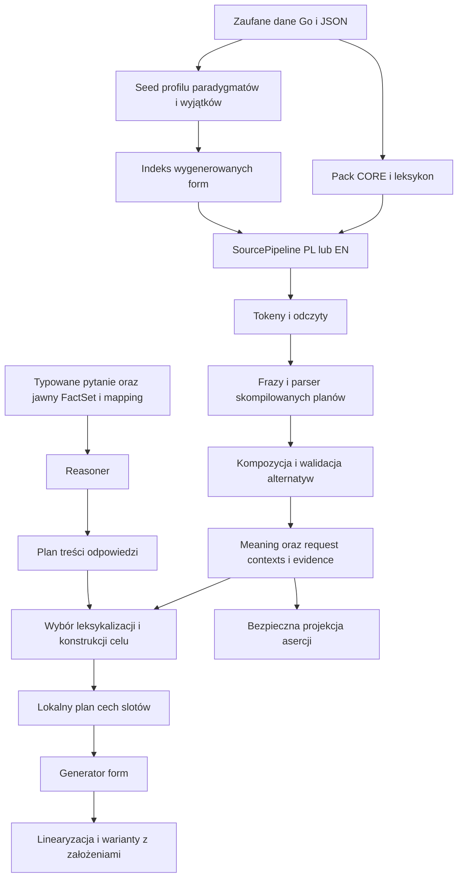

# Audyt spójności architektury i przyczyn braków GoLingua

Audyt [#352](https://github.com/clickbytes/golingua/issues/352), 2026-10-25. Baza: `532ec1a9b94f585cf61c66b6ddde72481e5789c7`; kod produktu jest taki sam jak w źródle raportu macierzy `e0ce950`. Wynik audytu: **DONE z jawnymi ograniczeniami szczegółowości diagnozy**. Ocena językowa agenta jest częścią ustaleń; akceptacja językowa właściciela: **NOT_EVALUATED**. Nie zmieniono implementacji, publicznych API, danych językowych, wzorców ani CI. Wynik napraw produktu pozostaje poza tym zadaniem.

Silnik ma spójny podział CORE, leksykonu, morfologii, konstrukcji, Meaning i faktów, ale jego rzeczywista zdaniowa obsługa PL/EN jest znacznie węższa niż katalog słów i deklaracji gramatycznych. Braki nie mają jednej przyczyny. Wykazano utratę kotwicy osoby w realizacji, błędny przypadek po polskiej negacji, brak liczby w części grafów EN oraz niespójne planowanie zgody dla angielskiego past. Obok nich występują brakujące dane i trasy, ograniczenia modelu znaczenia oraz niespójności kontraktów macierzy. Sama zmiana reprezentacji I nie naprawi tych wszystkich klas.

## Zakres dowodów i pełność powiązania z macierzą

Na bazowym SHA wykonano rzeczywiste `go test ./tests/... -count=1 -v`, z `GOLINGUA_MATRIX_SHA` ustawionym na pełne SHA. Exit code **1**. Bilans odtworzył istniejący raport:

| Ocena | Kontrole |
| --- | ---: |
| PASS | 297 |
| FAIL | 244 |
| GAP_ANALYZE | 946 |
| GAP_REALIZE | 433 |
| GAP_I | 1080 |
| SPEC_PENDING, INFRA, brak wyniku kontroli | 0 |

[checks.tsv](checks.tsv) obejmuje **wszystkie 3000 kontroli dla 1000 kierunków**, także PASS. Każdy niezaliczony etap ma jedną kategorię główną, rodzinę przyczyny, granicę diagnozy, poziom pewności i odsyłacze do linii wykonania. Dodatkowe blokery są osobno. [records.tsv](records.tsv) wiąże ID z wejściem, kierunkiem i MeaningID. [Katalog przyczyn](causes.md) definiuje rodziny; [115 dokładnych opisów brakujących znaczeń](gap-details.md) zachowuje powiązanie z 360 rekordami oznaczonymi GAP_I. Trzy GAP_I dla jednego kierunku nie oznaczają trzech niezależnych błędów.

Rozkład przyczyn głównych audytu (liczby kontroli, nie liczby defektów):

| Kategoria | Kontrole |
| --- | ---: |
| kontrakt testu | 73 |
| dane | 818 |
| morfologia | 769 |
| plugin analizy | 198 |
| plugin realizacji | 323 |
| mechanizm wspólny | 0 |
| integracja | 0 |
| reprezentacja znaczenia | 522 |

Zera w mechanizmie wspólnym i integracji oznaczają brak przypisanego, udowodnionego defektu jako przyczyny głównej tych 3000 wyników; nie są certyfikatem bezbłędności. Luka kontroli kontekstu i ograniczenie discovery CLI są ocenione osobno.

Osobno zachowano 205 dodatkowych kontroli i 32 kontrole odmów. **362 wywołania niezależnej realizacji nie zostały wykonane**, bo brakowało pełnego autorskiego I; liczba ta obejmuje także kontrole dodatkowe. Brak wyniku kontroli i niewykonanie adaptera są różnymi rzeczami. Nie oznaczono tych wywołań jako PASS.

Surowy [log macierzy](evidence/matrix.log.gz), [sondy etapów](evidence/probes.jsonl.gz), [CLI](evidence/cli.json.gz), [uzupełniające formy](evidence/cli-followup.json.gz), [pytania CLI](evidence/questions.json.gz) i [manifest z hashami](manifest.json) stanowią dowód wykonania. Numery linii w TSV odnoszą się do rozpakowanego `matrix.log`. To zapis istniejącego korpusu, bez nowego runnera, goldów i procentowej bramki.

„Ustalone” dotyczy granicy potwierdzonej w kodzie i obserwacji. Dla braku odczytu formy nie ustalono osobno dla każdego tokenu, czy brakuje leksemu, principal parts, komórki czy właściwej segmentacji. Dla każdej odrębnej odmowy celu nie ma śladu wszystkich odrzuconych gałęzi selekcji. Takie rekordy mają **ograniczoną diagnozę**, a nie pozornie dokładną przyczynę. Opis GAP_I jest wymaganiem korpusu; nie dowodzi, że żadna inna, jeszcze nieuzgodniona reprezentacja semantyczna nie byłaby możliwa.

## Mapa rzeczywistego wykonania



Nie ma automatycznej krawędzi od projekcji asercji do FactSet. Pytania CLI przyjmują typowane I i jawne fakty; nie przechodzą od pytania PL/EN przez analizator do reasonera. Snapshot nie zawiera wykonywalnego kodu ani pełnej morfologii. Rejestr języków sprawdza zgodność danych z zaufanym providerem, nie certyfikuje całego języka.

| Komponent | Wejście → wyjście i zależności | Ocena rzeczywistej odpowiedzialności i dostępności |
| --- | --- | --- |
| CORE i relacje | ConceptDefinition/RelationSchema → walidowany ConceptGraph | Neutralny wobec PL/EN. Definicje, role i typowe krawędzie nie są faktami o osobnikach. W runtime 1002 koncepty i 173 schematy relacji. Braki predykatów/roli są problemem danych, nie automatycznie schematu grafu. [`concept.go`](../../../internal/core/concept.go), [`relation.go`](../../../internal/core/relation.go). |
| Indeks grafowy | CORE → gęste ID, sąsiedztwo i bounded traversal | Działa dla ontologii; nie jest magazynem Meaning ani pamięcią świata. Typowe krawędzie i tranzytywność mają jawne polityki. [`graph`](../../../internal/graph/traversal.go). |
| Leksem, sens, binding | Dokument leksykalny → indeks oddzielnych rekordów | Rozdział zachowany. 1990 leksemów, 2023 sensy i 2011 bindingów w snapshotcie nie oznaczają tylu obsługiwanych form/tras zdań. Pending sensy pozostają widoczne. [`lexicon`](../../../internal/lexicon/index.go). |
| Walencja | Ramy ról i zatwierdzone wiązania → indeks | Kompilacja oddziela pending od runtime. Przypadek dopełnienia negatywnej trasy PL odziedziczono jednak po ramie dodatniej. [`valency`](../../../internal/valency/index.go), [`PL frames`](../../../languages/pl/valency.go). |
| Profile cech | Lokalny profil i znane/nieznane/nieobecne wartości → bundle/unification | Wspólne typy są w `internal/features`, inwentarz lokalny językowi. Granice: 64 wymiary, 128 wartości wymiaru. Brak defektu tych mechanizmów w badanych przykładach; błędne wartości wejściowe planu nie są ich winą. |
| Principal parts i paradygmaty | Leksem, części główne i żądanie cech → komórka/procedura | Działa na jawnych zasobach. Katalog jest szerszy niż seed form. `unknown` nie oznacza niepoprawnej gramatycznie formy. [`morph`](../../../internal/morph/generate.go). |
| Interpreter i wyjątki | Zweryfikowane operacje na tematach lub jawny wyjątek → forma i trace | Procedury są danymi, bez dowolnego kodu. Wyjątki rozdzielają replace/suppletion, wariant i stem override. 128 operacji, ograniczenia tematów i długości; nie stwierdzono defektu interpretera w sondach. [`procedure`](../../../internal/procedure/interpreter.go), [`exceptions`](../../../internal/morph/exception.go). |
| Indeks analizy form | Wygenerowane deklarowane komórki seed → inverse index | To skończona relacja, nie otwarty analizator całej fleksji. Zachowuje synkretyzm; limity 100 tys. odczytów i 32 MiB tabeli. Seed ma limit 128 leksemów PL / 160 EN. |
| Tokenizacja i lattice | Tekst, profil, indeks form, leksykon → tokeny z odczytami | Rzeczywiście podłączone. NFC i case folding nie dodają nieznanych form. MWE mechanizm istnieje, lecz oba SourcePipeline przekazują pustą listę MWEPlans. [`scan`](../../../internal/analyzer/scan.go), [`source`](../../../internal/runtime/source.go). |
| Frazy PL/EN | Lattice → kandydatury NP/VP/AP i ParseContext | Wspólny POS builder oraz lokalne adaptery rodzajników i wskazania. Nie jest to ogólny parser składni języka. Osoby i pro-drop wymagają osobnych tras. [`phrase_evidence`](../../../internal/runtime/phrase_evidence.go). |
| Konstrukcje i parser | Rodzina, wariant, walencja, profil → plany; frazy → forest | Parser rzeczywiście używa skompilowanych planów i constraintów. Brak początku planu i brak pełnego parse to różne granice. Limity domyślne: 4096 węzłów, 16384 alternatywy, 65536 rozwinięć. Samo posiadanie JSON question/quantity/PP nie dowodzi podłączenia pełnej trasy zdania. |
| Kompozycja i alternatywy | Forest, bindingi, operator/reference/attribute evidence → MeaningCandidate | Wspólny mechanizm zachowuje role, odrębność referentów i ograniczenia. Lokalne `SupportedSenses` i sygnatury form poświadczają pełne pokrycie operatorów tylko dla wąskich tras. Disambiguate waliduje/deduplikuje; nie odgaduje brakujących sensów. [`compose`](../../../internal/semantic/compose.go), [`disambiguate`](../../../internal/semantic/disambiguate.go). |
| MeaningGraph | Typowane węzły, role, past/present, one/many, zakresy → neutralne I | Wystarcza dla istniejących ograniczonych zdarzeń, black i części kompozycji. Nie ma samowystarczalnej typowanej zmiennej WH, ogólnego wiązania kwantyfikatora do roli, future/progressive/frequency ani relacji kolejności/przyczyny/kontrastu. [`types`](../../../internal/meaning/types.go). |
| Referencje i kontekst | Meaning + requestowe referenty/mentions/anchors → zweryfikowane powiązania | Kotwice speaker/addressee mieszczą się w istniejącym kontekście. Nie trzeba wpisywać gramatycznej osoby do CORE. Kontekst jest przenoszony wewnętrznie do realizatora, lecz nie wystarcza sama jego obecność: polityka celu musi go użyć. |
| Wybór leksykalizacji | I, indeksy, exact binding/variant i polityka języka → TargetCandidate | Wspólny selector sprawdza licencję; lokalne policy odrzucają dalsze kształty. Rozdzielono NO_LICENSED_TARGET od TARGET_NO_SURFACE_CANDIDATE. [`select`](../../../internal/realizer/select.go), [`target`](../../../internal/runtime/target.go). |
| Plan cech i wykonanie | Wybrana konstrukcja, role i I/context → sloty i Generate | Wspólny szkielet, lecz PL/EN mają duże ręczne rozgałęzienia po sense/family/variant. Tutaj wykazano ignorowanie speaker, brak past number i błędny case negacji. [`slot_execution`](../../../internal/runtime/slot_execution.go), [`EN target`](../../../languages/en/sentence_target.go), [`PL target`](../../../languages/pl/sentence_target.go). |
| Linearyzacja | Kanoniczny plan, formy slotów i wariant → tekst/segmenty | Używa skompilowanej sekwencji, weryfikuje tożsamość planu i pokrycie operatorów. Nie naprawia błędnych cech ani nie wybiera znaczenia. Brak wykazanego defektu własnego w sondach. [`linearize`](../../../internal/realizer/linearize.go). |
| Projekcja asercji | Jawny akt statement i I → asserted/unresolved | Działa zachowawczo: pytanie, negacja, hipoteza i kwantyfikator nie stają się dodatnimi faktami. Gołe zdarzenie też nie staje się asercją. [`project`](../../../internal/meaning/project.go). |
| Fakty | Jawny request context, binarne fakty z polaryzacją i źródłem → FactSet | Osobny, requestowy snapshot, nie ontologia i nie trwała pamięć. `AssertedMeaning` sprawdza projekcję, ale nie tworzy mapowania ról do faktu. Limit 4096 faktów. |
| Rozumowanie i pytania | FactSet, dopuszczone reguły i typowany mapping → proof/true/false/unknown/conflict | Działa binarnie; domknięcie dodatnie, negatywny dowód jawny. WH używa zewnętrznego GapRole. Odrzuca znaną ramę czasu i many; nie agreguje ilości. Domyślnie WH 64 kandydatów; reasoner 4096 derywacji, 100 tys. pracy, głębokość 32. [`reason`](../../../internal/reason/match.go). |
| Planowanie odpowiedzi i dialogue | Wynik reasonera → response Meaning → target runtime | Treść i dowody oddzielone od tekstu. True/false mają ograniczone trasy, WH/unknown/conflict mogą mieć poprawny wynik strukturalny i unsupported powierzchnię. [`planner`](../../../internal/planner/plan.go), [`dialogue`](../../../internal/dialogue/realize.go). |
| Import i staging | Manifest + bytes → zweryfikowany candidate/digest → aktywny snapshot | Ogólny snapshot importer przyjmuje CORE i leksykon, nie pełne profile/paradygmaty/wyjątki. UniMorph tworzy propozycje do przeglądu; nie uczy reguł ani nie aktywuje danych. Brak obejścia provenance wykazanego w tym audycie; nie przeprowadzano fuzzingu importera. |
| Pack i rejestr możliwości | Dokładny aktywny snapshot + trusted factories → zweryfikowany Engine | CLI kompiluje provider i etapy na wybranym snapshotcie; morfologia pochodzi z binarki. Registry weryfikuje deklaracje i dowody, nie semantyczną poprawność wszystkich wejść. [`config`](../../../internal/runtime/config.go), [`compiled`](../../../cmd/golingua/compiled.go). |
| Engine, CLI, TUI | Request → analiza/realizacja/statusy; Service → terminal | Engine zachowuje alternatywy i niepełność; maks. 256 alternatyw. CLI i macierz dały identyczne wyniki na 17 wejściach. TUI używa tego samego Service; interaktywne ekrany nie były ręcznie wykonywane w tym audycie. `capabilities` jest statycznym opisem procesu bez wybranego runtime, nie odczytem jego registry. |

## Potwierdzone przyczyny i doświadczenia rozdzielające warstwy

### Osoba nie znika w schemacie I, lecz przy użyciu kontekstu

Niezależne `a1.10.time.001.pl` ma seeing(person, dog), present/one i Mention `participant=speaker`. EN wybiera leksem `person`, planuje `person=third` i daje **The person sees the dog. / The person sees a dog.**, zamiast wymaganych **I see…**. Sonda zapisuje wejście, plan, części główne i cechy slotów. `englishSentenceFeatures` czyta osobę ze źródłowego Evidence, a przy jego braku wybiera third; selekcja NP nie interpretuje kotwicy mówiącego. PL dodatkowo zatrzymuje się na braku principal parts wybranego leksemu osoby. Natywne EN `I…` nie ma odczytu zaimka; PL `Widzę…` ma poprawny odczyt czasownika, lecz nie ma pełnego parse. To trzy odrębne blokery, nie jeden brak osoby w grafie.

### Negacja PL wybiera niepoprawny przypadek i potrafi zmienić liczbę

Dla **Nauczyciel nie widzi książki.** odczyty synkretyczne obejmują genitive singular oraz accusative plural. Negatywna rodzina nie zmienia przypadka dopełnienia ramy `widzieć` z accusative na genitive. Wybrany odczyt to accusative plural, a końcowe I ma **book many**. Mapowanie plural → many wykonuje poprawnie swoje zadanie na błędnie wybranym wejściu. W drugą stronę niezależne I daje **Nauczyciel nie widzi książkę.**, a inne rekordy dają **Matka nie słyszy ptaki.** i **Lekarze nie widzą samochód.** Generator wykonuje żądany biernik; naprawa samych końcówek nie usunie przyczyny. Kontrole z psem mogą przechodzić dzięki identyczności form `psa` w acc/gen; PASS nie dowodzi właściwego rządu negacji.

### Past EN ma formę, ale plan nie dostarcza cechy wymaganej przez konstrukcję

Niezależna realizacja `A1.10-TIME-1034-PL-EN` wybiera `en.see.v` z principal part **saw**. Helper dla past daje verb_form/tense/mood/voice, pomija number, choć subject ma singular, a konstrukcja wymaga hard agreement number. Wynik: **hard agreement feature values must be explicitly known on both slots**. Wspólny wykonawca zasadnie odmawia. To niespójność lokalnego planu EN z wybraną rodziną; nie brak odmiany `see` i nie brak past w I.

### Znana powierzchnia i duży katalog nie zapewniają analizy zdania

Sondy `Widzę psa.`, `Psa widzi nauczyciel.` i `The teacher saw the dog.` pokazują dostępne odczyty form, ale brak pełnego planu/poświadczenia obsługiwanej trasy. SVO i OVS mają różne przypisania ról; dla synkretycznych pluralnych `Koty widzą psy.` brakuje wymaganego grafu `.swap`. Child/children ma tylko sens wieku; relację potomka przypisano osobnemu leksemowi **offspring**, więc wymagane `.offspring` nie powstaje z child. Przeniesienie tego problemu do disambiguatora nie dostarczy brakującego sensu w danych.

`letter_document`, `window` i `apple_fruit` mają formy, ale nie należą do `englishCountNounLexemes`. `englishNodeAttributes` przenosi liczbę tylko dla leksemów oznaczonych count. Dlatego **The mother read the letter.**, **This window is black.** i **This apple is black.** gubią `one` na tym referencie. Dane liczby muszą być spójne z indeksem form; sam synkretyzm `read` nie odpowiada za ten brak.

### Określoność i kompozycja mają ograniczenia po stronie celu

PL nie dostarcza angielskiej określoności. Wymagane alternatywy pozostają jawne w kontraktach. Polityka EN dla plural bez źródłowego determiner zachowuje tylko definite, a osobny wariant reading ma terminale `the`. Brakuje wymaganych bare plurals i części kombinacji a/the. Nie należy „naprawiać” tego przez zgadywanie jednej określoności w I.

`black(subject)+seeing(subject,object)` jest działającą ograniczoną kompozycją. Inne modyfikatory, wiele zdarzeń lub inny punkt przypięcia nie zyskują obsługi tylko dlatego, że graf jest legalny. Selector/target odmawia przy braku pełnego pokrycia leksykalnego. Dla niektórych kompozycji I wystarcza i brak leży w realizacji; dla warunku, alternatywy, przyczyny, kontrastu, heterogenicznej grupy i określonych zakresów kwantyfikacji brakuje pełnego kontraktu I.

### Posiadanie, przestrzeń, ilość i WH wymagają różnych napraw

Generic HAVE i possessive association nie mają odpowiednich neutralnych predykatów; legal ownership nie jest automatycznym odpowiednikiem „mieć”. To brak danych semantycznych. Istniejące przestrzenne/posiadaniowe `KindRelation` nie przechodzą jako Meaning State/Event. W tym miejscu trzeba zdecydować o jawnej reprezentacji stanowej albo świadomym rozszerzeniu kontraktu I; nie wystarczy dodać angielskiego słowa `have` lub przyimka `in`.

`exactly(2) → cat(many)` jest legalnym komponentem ilości, ale nie wyraża czasowanego zdania **There are two cats.** CORE existence nie ma roli dla liczonego zbioru; nie można przenieść temporal_frame na kwantyfikator lub referent. Dla woman brakuje także odpowiedniego konceptu. Z kolei pełne WH potrzebuje zmiennej i jej restrykcji/wiązania. Działający zewnętrzny `GapRole` reasonera nie dowodzi, że sam Meaning zachowuje tę informację. [Szczegóły każdego wymagania](gap-details.md) nie zastępują tych odmiennych problemów wspólnym hasłem „brak I”.

### Projekcja, fakty i odpowiedzi zachowują granice prawdy

Sonda projekcji tego samego zdarzenia dała jedną asercję wyłącznie pod `statement`; bare, negation, question, hypothetical i quantifier dały zero asercji z jawnym powodem. Podwójna negacja odmówiła bez częściowej asercji.

Dla tej samej relacji i referentów: brak faktu → **unknown**, dodatni → **true**, ujemny → **false**, obie polaryzacje → **conflict**. CLI zachował proof i źródła; przy `--language pl` true/false dały ograniczoną odpowiedź z założeniami, a unknown/conflict nie miały wspieranej powierzchni. Typowane WH z dwoma pasującymi nauczycielami zachowało oba trafienia; tekst pozostał unsupported. Znany present w pytaniu został jawnie odrzucony jako `UNSUPPORTED_QUESTION_TEMPORAL_FRAME`. Nie zaobserwowano zamiany braku faktu w fałsz ani awansowania hipotezy do twierdzenia.

## Odmiana i niezależna ocena form

Wykonano 11 żądań generacji z oczekiwaniem zapisanym przed wykonaniem w [morph-requirements.json](evidence/morph-requirements.json), następnie analizę każdej uzyskanej formy. Poprawne były: **looked, read, children, cities, widzę, czytałam, psa** (osobno acc i gen), **końmi**. Każda z tych dziewięciu generacji wróciła do właściwego leksemu/komórki przez Analyze. Wymagania pochodzą z istniejących autorskich form i korpusu, a nie z pętli generatora. To ograniczona ocena agenta, nie nowy zestaw akceptacyjny właściciela.

Dwie odmowy pozostały widoczne: `en.fish.n` był błędnym ID sondy; właściwe `en.fish_animal.n` wygenerowało **fish**, a analizator zachował singular i plural. `pl.czarny.adj` w feminine singular nominative zwrócił unknown, podczas gdy obsługiwana masculine_animal singular nominative dała **czarny**. Nie uznano tego za złą końcówkę generatora: brakuje wymaganej komórki w ograniczonym paradygmacie identyfikacji.

Ślad **looked** zawiera select_stem + append(ed), a **cities** transformację suffix y → ies. **children** i nieregularne **read** wybierają zapisane principal parts. **końmi** w tej trasie wybiera zapisaną principal part, bez exception_id; **psa** pokazuje synkretyzm. Seed PL ładuje pusty plik wyjątków, a sondy nie wykazały aktywnego wyjątku w obu seed. Infrastrukturę wyjątków oceniono źródłowo; wykonanie replace/stem override/add_variant: NOT RUN, bo nie ma odpowiednich aktywnych danych w badanej trasie. Istnienie procedury `select_stem` nie czyni tabeli zapisanych pełnych form produktywną regułą odmiany. Sondy sprawdzają różne mechanizmy; sam Generate→Analyze nie jest niezależnym dowodem poprawności językowej.

## Kontrakty macierzy oraz ryzyko fałszywej oceny

Porównanie grafów ma pełną bijekcję węzłów, zachowuje role, liczbę, czas i zakresy; nie scala dwóch kotów w jednego. ContextMatches wiąże kotwicę z tą samą bijekcją. Nie stwierdzono fałszywego PASS tego mechanizmu w wykonanych kontrolach.

**The teacher sees the book.** tworzy poprawny zatwierdzony graf, ale pending sens `book.work` utrzymuje incomplete. Analiza macierzy wymaga statusu OK każdego kandydata i daje FAIL; integracja może pokazać ten graf jako niepełny przekład i zaliczyć zapisany kontrakt tekstów/założeń. To różnica wymagań, nie dowód błędnego grafu ani uzasadnienie usunięcia ostrzeżenia. Rodzina D-SENSE zachowuje niezatwierdzony sens; nie zaleca się cichej automatycznej akceptacji bindingu.

W nowszych partiach część kontraktów nie dopuszcza `person=third`, choć annotator dodaje je do zwykłego nominalnego podmiotu, a pierwotne kontrole je dopuszczają. C-ASSUMPTION opisuje tę niespójność. Trzeba rozstrzygnąć, kiedy osoba wynika z konstrukcji i wybranego NP, a kiedy jest rzeczywistym założeniem. Nie wolno zbiorczo poszerzyć allowed fields tylko dla zielonego wyniku. Osobno **To jest ryba.** ma kontrakt tylko animal, a analizator zwraca też food z one; ocena dopuszczalności tego odczytu i liczby jest **hipotezą**, nie potwierdzonym błędem wzorca.

Istnieje też ograniczenie dowodu kontekstu w integracji: kontrola bada osobno source context i wiąże SourceCandidateID z MeaningID, ale `MatchSourceCandidateMeaning` porównuje potem sam graf. TranslationAlternative nie eksportuje request context. Taka kontrola nie wykryje każdej wewnętrznej utraty/przepięcia kotwicy, jeśli graf i ID pozostaną takie same. Kod engine przekazuje kontekst do target, a sonda speaker potwierdza jego obecność na wejściu; **nie stwierdzono tu utraty w transporcie**, tylko lukę obserwowalności kontroli. Wymagane warianty i Meaning integracyjnego wyniku są sprawdzane. Dla osobnego source probe brak wymaganych Meaning ustawia jednak tylko `sourceGap`, bez własnego błędu kontroli; flaga wpływa na klasyfikację dopiero przy unsupported lub pustym wyniku integracji. Udana integracja może więc przejść mimo braku w tym osobnym probe, jeśli sama pokryła wszystkie wymagane Meaning. Nie dowodzi to utraty w obecnym deterministycznym adapterze, ale ogranicza odporność kontroli na rozbieżność między wywołaniami. To wymaga ostrożności w interpretacji PASS, bez zmiany publicznego API w audycie.

## Spójność granic i dokumentacji

CORE nie importuje pluginów PL/EN. Wspólne features, morfologia, parser, composer, selector i linearizer są rzeczywiście używane. Jednocześnie językowe adaptery ręcznie powtarzają sprawdzanie kształtu Meaning, roli, czasu, liczby i konkretnego sense/family/variant. Konstrukcja steruje kolejnością i constraintami, ale nie całą decyzją o dopuszczalności zdania. Nowy rzeczownik w już wspieranej klasie wymaga lokalnego wpisu oraz zgodnych form/właściwości; nowe zdarzenie zwykle wymaga dziś rozproszonych zmian w leksykonie, walencji, bindingach, konstrukcjach, allowlistach analizy i polityce celu. To wykazane sprzężenie, bez przesądzania o nowej abstrakcji.

Jeśli naprawa konkretnej trasy uzasadni wydzielenie odpowiedzialności, najbliższym kandydatem jest **lokalny plan cech związany z konstrukcją**: wejście to I+context, wybrana rama i role NP; wyjście to cechy slotów, uzgodnienia oraz jawne założenia/straty. Korzyść dotyczy speaker, past number i negatywnego case. Nie oznacza to uniwersalnej gramatyki, przeniesienia odmiany do CORE ani zaprojektowania GoLingua v2. Decyzja o wydzieleniu wymaga własnego zamkniętego zakresu; ten audyt nie tworzy backlogu.

[README architektury](../../architecture/README.md) trafnie opisuje wąskie trasy; historyczne zakazy testów i wcześniejsze obserwacje należy czytać według daty oraz nowszych decyzji AGENTS. „1000 konceptów” i „135 konstrukcyjnych wiązań” to inwentarz, nie dowód obsługi A1. Manifest morfologicznego seed z sentence_analysis=unsupported opisuje seed; zdaniowy provider jest kompilowany oddzielnie. `capabilities --json` bez config zwraca statyczne ready=false mimo zbudowanego i załadowanego w innych żądaniach runtime. To ograniczenie komendy discovery, nie nieudane ładowanie snapshotu. W sondzie użyto również nieistniejącego `runtime --config`; zachowane INVALID_COMMAND jest błędem doboru komendy sondy, nie błędem produktu.

## Kolejność zalecanych napraw

1. **Zachować informację i poprawić błędne znaczenia:** negatywny case PL przed wyborem synkretycznej formy; speaker/addressee w leksykalizacji i zgodzie; count metadata EN i wymagane odczyty child. Każdą naprawę sprawdzić niezależnym I, analizą oraz integracją na istniejących rekordach.
2. **Uzgodnić kontrakty i integrację:** past EN vs hard agreement, person assumptions dla nominalnych NP, zachowanie wariantów określoności oraz obserwowalność kotwic. Nie zmieniać expected pod aktualny output. Zachować pending sense i jawne incomplete.
3. **Zamknąć semantykę brakujących domen:** rozdzielić dane HAVE/association/existence od KindRelation oraz ograniczeń zmiennych WH, kwantyfikacji i czasu. Każda decyzja musi zachować role, zakres, niewiadome i pochodzenie; nie wypełniać pełnego zdania niepełnym komponentem.
4. **Rozszerzać pionowe możliwości:** formy i sense/binding, konstrukcja, poświadczenie analizy, plan celu, niezależna realizacja, CLI. Samo mnożenie leksemów albo wariantów JSON nie daje używalnej trasy. Dopiero potwierdzona powtarzalność napraw uzasadnia ograniczone wydzielenie wspólnego komponentu.

Nie zlecono implementacji tych zaleceń ani uczenia LIGHT-L. Audyt nie wykazuje oszczędności energii, równoważności z modelem neuronowym ani kompletnej poprawności językowej.

## Odtworzenie i odbiór

Środowisko: Go 1.27.0, Linux amd64; data 2026-10-25 Europe/Warsaw. Macierz i CLI uruchomił koordynator w rzeczywistym terminalu. Dwa ograniczone przeglądy Luna Low były wyłącznie odczytowe: morfologia/pakiety i kontrakty kontroli oraz Meaning/logika i parser. OpenCode nie użyto do pracy: dzisiejsza notatka `/tmp/golingua-opencode-audit-20261025/coordinator-note.md` dokumentowała brak wskazanego workera w diagnostyce i nieweryfikowane odmowy shell/network/subagent. CodeGraph odmówił EACCES przy indeksie; użyto źródeł. Nie ingerowano w istniejące nieśledzone pliki użytkownika.

Pełny log można odtworzyć bez nowej infrastruktury:

```sh
GOLINGUA_MATRIX_SHA=532ec1a9b94f585cf61c66b6ddde72481e5789c7 go test ./tests/... -count=1 -v > /tmp/architecture-matrix.log 2>&1
# zapisany wynik tego polecenia: exit 1
python3 -B scripts/report-language-matrix.py --sha 532ec1a9b94f585cf61c66b6ddde72481e5789c7 --exit-code 1 --log /tmp/architecture-matrix.log > /tmp/architecture-matrix.md
```

Sondy nie są częścią produktu ani zestawu testowego. Zarchiwizowany [kod sondy](evidence/probe.go.txt) należy skopiować do `cmd/auditprobe/main.go` w jednorazowej kopii `git archive` bazowego SHA bez `.git` i poświadczeń. W tym samym katalogu rozpakować log i wydobyć JSON po markerach `observation=` oraz `matrix_inventory=` istniejącym `marked_json` ze skryptu raportu. Wywołanie: `go run ./cmd/auditprobe observations.json inventory.json`. Ekstrakcja wejść sondy w tej kopii (po umieszczeniu rozpakowanego `matrix.log` w jej katalogu):

```sh
python3 -B - <<'PYTHON'
import importlib.util, json
spec = importlib.util.spec_from_file_location("matrix_report", "scripts/report-language-matrix.py")
report = importlib.util.module_from_spec(spec)
spec.loader.exec_module(report)
log = open("matrix.log").read()
for marker, path in [("observation=", "observations.json"), ("matrix_inventory=", "inventory.json")]:
    values, errors = report.marked_json(log, marker)
    assert not errors, errors
    with open(path, "w") as output:
        json.dump(values, output, ensure_ascii=False)
PYTHON
go run ./cmd/auditprobe observations.json inventory.json > probes.jsonl
```

Otrzymane JSONL pokazuje tokeny/odczyty, kandydatów, forest, evidence, Meaning, plany/sloty, powierzchnię, projekcję, CORE lookup oraz truth. Kody pomocnicze CLI zawierają dokładne argumenty, wejścia pytań i exit codes; ich ścieżkę `/tmp/golingua-architecture-audit-20261025` należy wskazać na własną jednorazową lokalizację.

Dla zmian samych dokumentów nie powtarzano lokalnego vet ani pełnego builda jako rytuału CI. Build CLI był potrzebny do eksperymentów. Kontrole raportu obejmują kompletność i unikalność 3000 powiązań, zgodność statusów z surowym logiem, hashe dowodów, linki lokalne i `git diff --check`. Faktyczny CI PR i końcowego main oraz scalenie są zapisane w [issue #352](https://github.com/clickbytes/golingua/issues/352); nie zastępuje ich lokalna deklaracja PASS.
